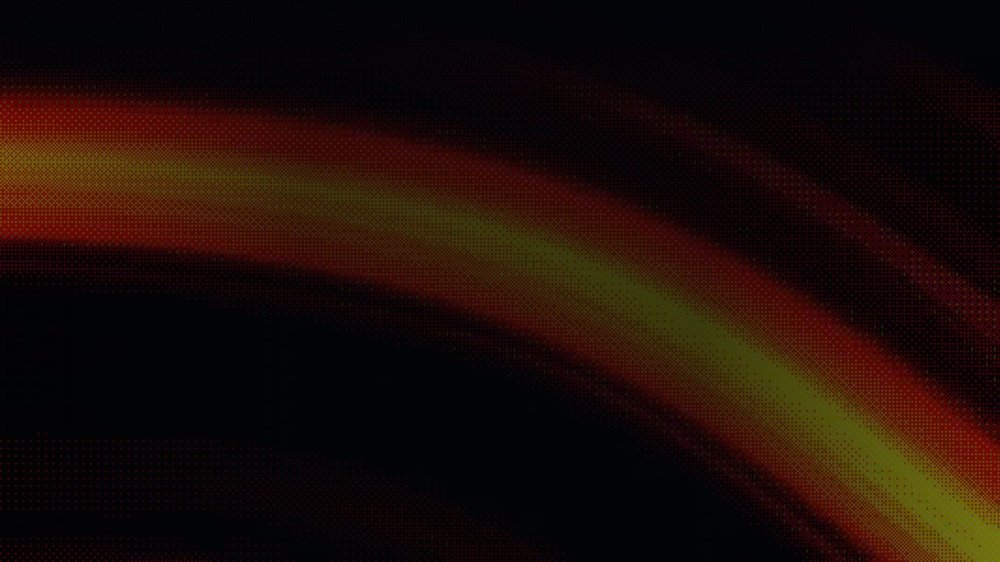
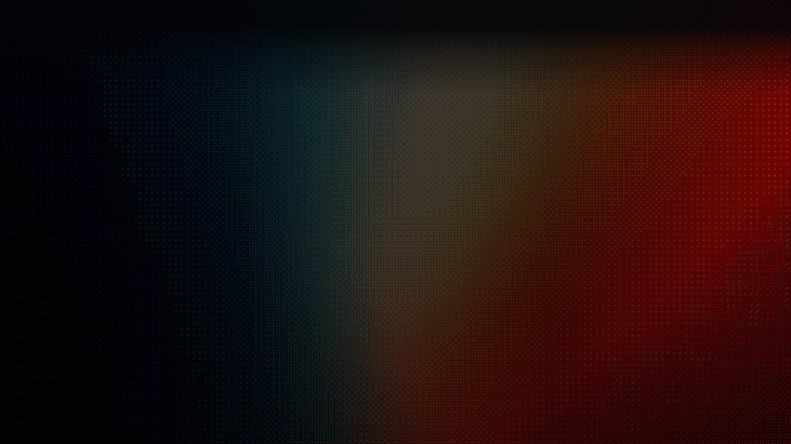
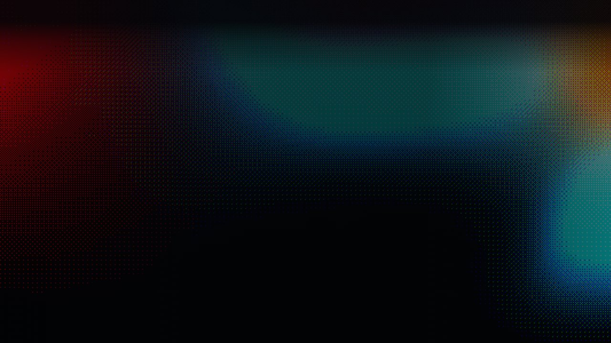
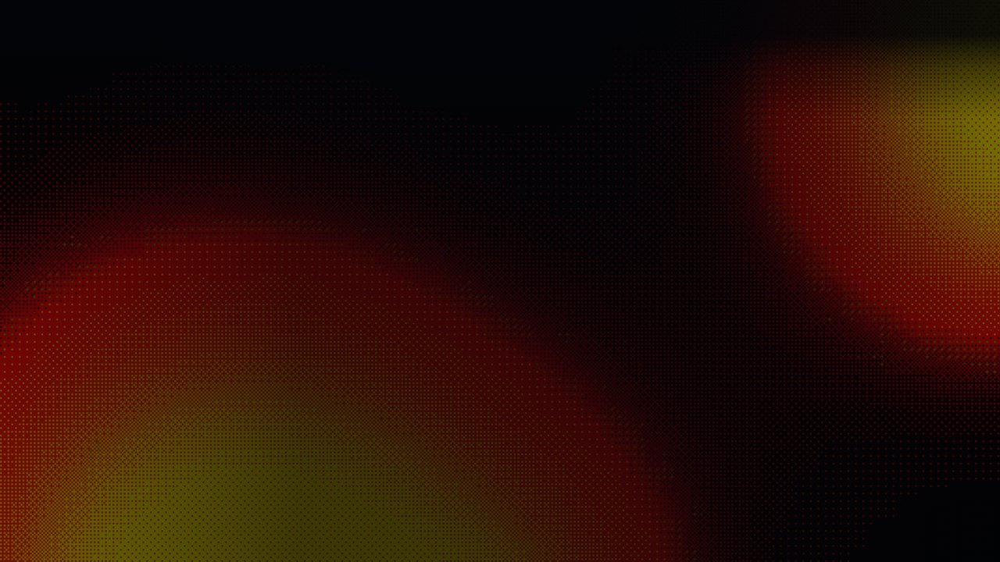
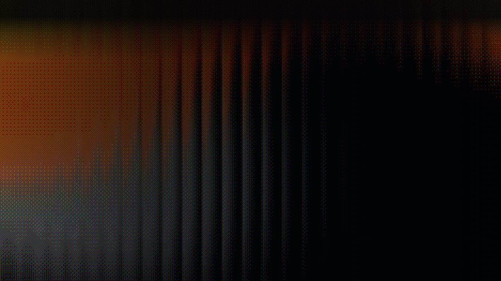
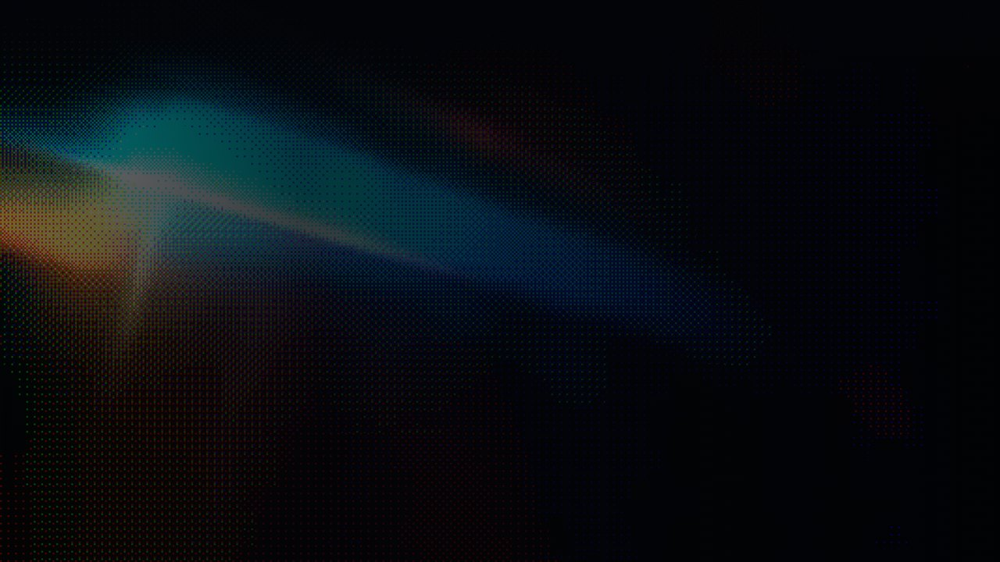

# T3 Code dotted gradient

Dither Live is a dark theme for [T3 Code](https://github.com/pingdotgg/t3code) whose background changes on its own. Every 20 minutes a small macOS helper swaps in the next of 10 dithered backgrounds and an accent color to match. You don't have to click anything.

<table>
  <tr>
    <td></td>
    <td></td>
    <td></td>
  </tr>
  <tr>
    <td align="center">Arcs</td>
    <td align="center">Horizon</td>
    <td align="center">Neon</td>
  </tr>
  <tr>
    <td></td>
    <td></td>
    <td></td>
  </tr>
  <tr>
    <td align="center">Ember</td>
    <td align="center">Flutes</td>
    <td align="center">Streaks</td>
  </tr>
</table>

Six of the ten backgrounds are shown above. The others are Dither, Dusk, Gold and Glint.

## Set it up with your agent

Paste this into a T3 Code thread:

```text
Set up the Dither Live theme for T3 Code on this Mac.

1. Clone https://github.com/Marve10s/t3code-dotted-gradient into ~/.config/t3code-dotted-gradient. If that folder already exists, run git pull there instead.
2. Check that T3 Code's CLI exists at ~/.t3/bin/t3. If it is missing, stop and tell me to open T3 Code once and try again.
3. Run ~/.config/t3code-dotted-gradient/install.sh. If I asked for a different interval, pass it in minutes, for example install.sh 10.
4. Run ~/.t3/bin/t3 theme show and confirm the environment theme is "dither-live".
5. Tell me which background is showing now and that ~/.config/t3code-dotted-gradient/uninstall.sh stops the rotation.
```

## Set it up yourself

```sh
git clone https://github.com/Marve10s/t3code-dotted-gradient ~/.config/t3code-dotted-gradient
~/.config/t3code-dotted-gradient/install.sh
```

Keep the folder where you cloned it. The helper runs the scripts from there.

## Requirements

- macOS
- T3 Code desktop 0.1.0 or later, opened at least once so it writes its CLI to `~/.t3/bin/t3`

## How it works

T3 Code themes are JSON files with colors and CSS. This repo holds 10 of them in [`themes/`](themes). They share one layout and differ in background art and accent color.

`install.sh` adds a launchd job that runs [`rotate.sh`](rotate.sh) every 20 minutes. The script uses the clock to pick a theme file and publishes it under the id `dither-live` with `t3 theme set`. T3 Code sees the new theme and fades to the new background.

The helper only changes the theme while Dither Live is your active theme. Pick another theme in T3 Code settings and the rotation pauses. Pick Dither Live again and it picks up at the next interval.

## Change the interval

Run the installer again with a number of minutes:

```sh
~/.config/t3code-dotted-gradient/install.sh 5
```

## Use one background without rotation

```sh
~/.t3/bin/t3 theme set --id dither-live ~/.config/t3code-dotted-gradient/themes/05-arcs.json
```

Then run `uninstall.sh` so the helper doesn't replace it.

## Add your own background

1. Put a photo in [`source/photos/`](source/photos).
2. Add an entry to [`source/sources.json`](source/sources.json) with its slug, an accent color and a gamma value. A higher gamma darkens the photo.
3. Run `python3 source/build.py` (needs [Pillow](https://pypi.org/project/pillow/)).

The build checks text contrast against the background and stops if a color fails.

## Uninstall

```sh
~/.config/t3code-dotted-gradient/uninstall.sh
```

This stops the rotation. Dither Live keeps its current background until you choose another theme.

## Credits

Nine backgrounds start from photos on Unsplash, used under the [Unsplash License](https://unsplash.com/license). The Dither background is original.

| Background | Photo by |
|---|---|
| Streaks | [Rana Mia](https://unsplash.com/photos/abstract-streaks-of-blue-red-and-yellow-light-Rz2qamn3cVE) |
| Horizon | [Asif Aether](https://unsplash.com/photos/a-gradient-of-blue-white-and-orange-4KRfJsZIra0) |
| Flutes | [Erkan Aktaş](https://unsplash.com/photos/abstract-orange-and-grey-gradient-with-vertical-lines-2wHLQHP_j7c) |
| Arcs | [Julian Rösner](https://unsplash.com/photos/abstract-flowing-lines-of-orange-and-yellow-light-uDrWDhyOhow) |
| Ember | [asi mong](https://unsplash.com/photos/abstract-warm-orange-and-black-gradient-4yRLPPy5Qss) |
| Dusk | [Codioful](https://unsplash.com/photos/red-and-blue-light-digital-wallpaper-yXs4rWNK-mg) |
| Neon | [Gradient Wallpapers](https://unsplash.com/photos/a-blurry-image-of-a-red-and-blue-background-PFKx7Srejek) |
| Gold | [Liana S](https://unsplash.com/photos/golden-light-streaks-across-dark-background-f-PBlsSXjAs) |
| Glint | [Liana S](https://unsplash.com/photos/golden-light-flares-on-a-dark-background-58SMyKAKmmg) |

## License

The code and theme files are MIT licensed. See [LICENSE](LICENSE). The photos stay under the Unsplash License.
